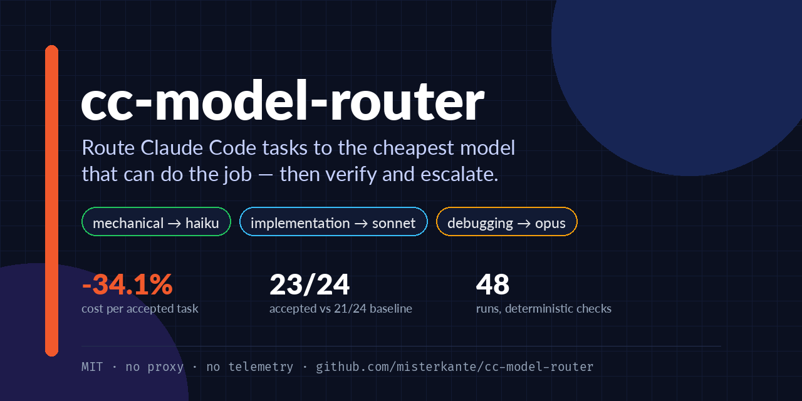
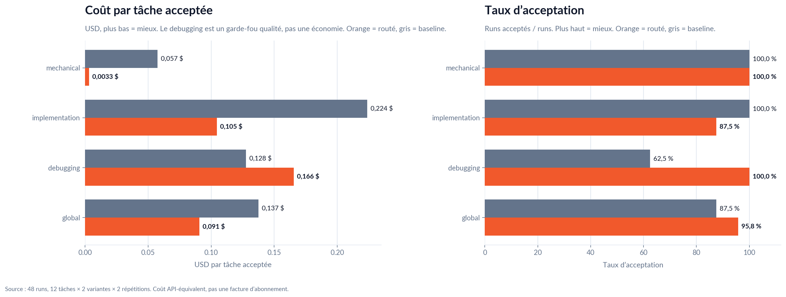
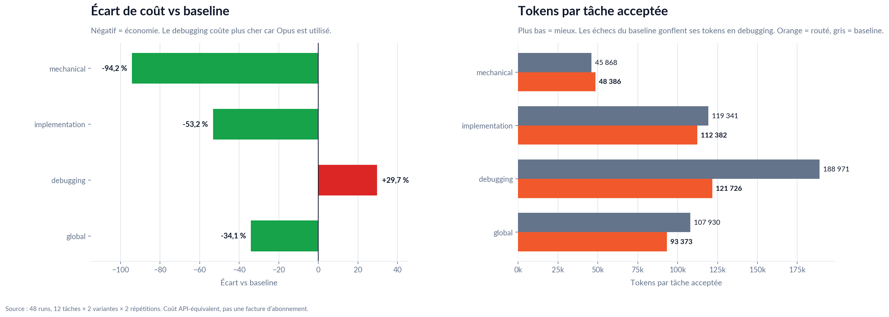

# cc-model-router

[English](README.md) · [Français](README.fr.md)

> Routage automatique de modèles pour Claude Code — classifie chaque tâche, choisit le modèle le moins cher capable de la faire, et arrête de taper `/model` à la main.

[](https://github.com/misterkante/cc-model-router/actions/workflows/ci.yml)
[](https://github.com/misterkante/cc-model-router/releases)
[](LICENSE)
[](https://www.npmjs.com/package/cc-model-router)
[](#benchmark)

**Statut : MVP (0.1.1).** Claude Code d’abord ; le support OpenCode est sur la roadmap. Voir l’[index de documentation](docs/README.fr.md) pour le benchmark, la veille et les notes de lancement.

<p align="center"></p>

## Installation

```bash
npm install -g cc-model-router
ccmr status
```


Le package expose deux commandes équivalentes : `cc-model-router` et `ccmr`. Sans installation globale :

```bash
npx cc-model-router status
```

Depuis un clone (développement) :

```bash
git clone https://github.com/misterkante/cc-model-router.git
cd cc-model-router
npm link
ccmr status
```

Prérequis : Node.js >= 18 et une version de Claude Code qui supporte `--effort` et `--fallback-model` (testée sur 2.1.309).

## Pourquoi

En 2026, tous les devs utilisent Claude Code, et le budget de tokens est le goulot d’étranglement commun. La plupart des sessions restent sur Opus même pour un `git commit`, un renommage ou un lint. Ce routeur mappe trois tiers de tâches vers trois modèles et garde le modèle cher pour le travail qui en a besoin.

| Tier | Modèle | Tâches typiques |
|---|---|---|
| `mechanical` | haiku | git, renommages, formatage, lint, recherches |
| `implementation` | sonnet | features, edits, tests, refactors |
| `debugging` | opus | bugs, régressions, tests flaky, analyse profonde |

## Comment ça marche

1. Le classifieur score le prompt contre les trois tiers et renvoie une confiance plus les mots-clés détectés.
2. La config globale (`~/.claude/model-router.json`) est fusionnée avec la config projet (`.claude/model-router.json`) ; le projet gagne.
3. `ccmr run` mappe le tier vers `--model`, `--effort` et `--fallback-model`, puis lance Claude Code.
4. Le hook optionnel logge la recommandation et l’ajoute au contexte de Claude ; la status line affiche le modèle actif et le mapping des tiers.
5. Avec `--verify`, une commande déterministe décide si le run est accepté. Avec `--escalate`, un check échoué retente avec le tier suivant et inclut la sortie d’échec.

Le hook ne peut pas changer le modèle actif en cours de session ; il observe et recommande. `ccmr run` applique le modèle au lancement.

## Démarrage rapide

```bash
ccmr classify "debug why the login test is flaky"
```

Sortie :

```json
{
  "tier": "debugging",
  "model": "opus",
  "effort": "high",
  "confidence": 1,
  "matched": ["debug", "flaky"],
  "scores": { "mechanical": 0, "implementation": 0, "debugging": 6 }
}
```

Lancer Claude Code avec le modèle routé :

```bash
ccmr run "implement the auth endpoint"
# équivalent à : claude --model sonnet --effort medium --fallback-model haiku "implement the auth endpoint"
```

Passer des flags Claude Code supplémentaires après `--` :

```bash
ccmr run "implement the auth endpoint" -- -p
```

### Vérifier et escalader

Lancer un check après la tâche, et retenter avec le tier suivant s’il échoue :

```bash
ccmr run "implement the auth endpoint" --verify "npm test" --escalate
```

- `--verify "<commande>"` s’exécute après Claude, dans le répertoire courant.
- Les flags du routeur vont avant `--` ; tout ce qui est après `--` est passé à Claude Code.
- Sans `--escalate`, un échec est signalé et `ccmr` sort en erreur.
- Avec `--escalate`, un check échoué retente avec le tier suivant (`mechanical → implementation → debugging`) et inclut la sortie d’échec dans le prompt de retry.
- Le code de sortie de Claude est rapporté ; la commande de vérification est le juge. Si le check passe, le run est accepté même si Claude a quitté avec un code non nul.
- Utilise un check en lecture seule (tests, typecheck, lint). Une commande qui réécrit des fichiers change l’état vu par le retry.
- Le retry réutilise l’arbre de travail et **ne fait pas de rollback**. Commit ou stash d’abord si tu as besoin d’un retour arrière propre.
- La commande de vérification est fournie par l’utilisateur et tourne avec tes permissions shell.

Cela ferme le seul vrai échec qualité mesuré dans le benchmark 48 runs : Sonnet a produit un YAML invalide, et un retry Opus aurait eu la sortie du parser pour corriger.

Dry run (afficher la commande sans l’exécuter) :

```bash
CC_ROUTER_DRY_RUN=1 ccmr run "lint the files"
```

Afficher la table de routage effective :

```bash
ccmr status
```

### Référence CLI

| Commande | Rôle |
|---|---|
| `ccmr classify "<tâche>"` | Affiche tier, modèle, effort, fallback, confiance et mots-clés en JSON. |
| `ccmr run "<tâche>" [--verify "<cmd>"] [--escalate] [-- <flags claude>]` | Classifie et lance Claude Code avec le modèle choisi. |
| `ccmr status` | Affiche la config effective et le mapping tier → modèle. |
| `ccmr hook` | Mode hook ; lit un payload Claude Code `UserPromptSubmit` sur stdin. |

Variables d’environnement utiles :

| Variable | Rôle |
|---|---|
| `CC_ROUTER_CONFIG_DIR` | Déplace la config globale et le log du routeur ailleurs. |
| `CC_ROUTER_CLAUDE_BIN` | Remplace le binaire `claude` utilisé par `run`. |
| `CC_ROUTER_DRY_RUN=1` | Affiche la commande Claude au lieu de l’exécuter. |

## Configuration

- Globale : `~/.claude/model-router.json`
- Projet : `.claude/model-router.json` (gagne sur la globale)

```json
{
  "defaultTier": "implementation",
  "debuggingStrategy": "opus",
  "debuggingFirst": { "model": "sonnet", "effort": "medium" },
  "tiers": {
    "mechanical": { "model": "haiku", "effort": "low" },
    "implementation": { "model": "sonnet", "effort": "medium" },
    "debugging": { "model": "opus", "effort": "high" }
  },
  "extraKeywords": {
    "mechanical": ["bump deps"],
    "debugging": ["segfault"]
  }
}
```

Voir `examples/model-router.json` pour un fichier prêt à copier, et
`examples/model-router.sonnet-first.json` pour la politique de debugging opt-in.

### Option : debugging Sonnet-first

Mets `"debuggingStrategy": "sonnet-first"` pour essayer Sonnet sur les tâches de debugging d’abord, puis retenter avec le tier debugging configuré (Opus par défaut) quand `--verify` échoue. Cela ne s’applique que si **`--verify` et `--escalate` sont fournis** ; sans filet de sécurité, le debugging reste sur Opus. Le premier essai se configure avec `debuggingFirst` (défaut `sonnet` / `medium`).

Une simulation à partir des 48 runs estime **-15,5 % de coût par tâche acceptée en debugging** vs Opus-first, à 8/8 acceptés, avec 3/8 retries. C’est une simulation, pas un nouveau benchmark : voir [`docs/BENCHMARK.fr.md`](docs/BENCHMARK.fr.md) et `node bench/simulate-escalation.mjs`.

## Intégration Claude Code

Ajoute le hook et la status line à tes settings Claude Code :

```json
{
  "hooks": {
    "UserPromptSubmit": [
      {
        "hooks": [
          {
            "type": "command",
            "command": "node /absolute/path/to/cc-model-router/hooks/user-prompt-submit.js"
          }
        ]
      }
    ]
  },
  "statusLine": {
    "type": "command",
    "command": "node /absolute/path/to/cc-model-router/bin/statusline.js"
  }
}
```

Le hook logge chaque classification dans `~/.claude/router.log` et ajoute le tier/modèle recommandé comme contexte additionnel.

## Test isolé (sans toucher au vrai `~/.claude`)

Deux mécanismes de sécurité :

- `CC_ROUTER_CONFIG_DIR` déplace la config globale et le log du routeur dans un répertoire sandbox.
- `claude --settings <fichier>` charge le hook et la status line pour une seule session Claude Code.

Smoke test (dry run, vraie config intacte) :

```bash
./scripts/sandbox.sh
```

Lancer une session Claude Code sandboxée avec le hook du routeur :

```bash
./scripts/claude-sandbox.sh
```

Ton `~/.claude/settings.json` et ton `~/.claude/model-router.json` ne sont jamais modifiés. L’auth est préservée car `HOME` n’est pas remplacé.

## Benchmark

**12 tâches × 2 variantes × 2 répétitions = 48 runs**, checks automatiques, copies isolées. Résultat principal : **-34,1 % de coût par tâche acceptée** et **95,8 % de taux d’acceptation vs 87,5 %**, avec **-5,2 %** de tokens bruts au total.

| Métrique | Routé | Baseline | Écart |
|---|---:|---:|---:|
| Runs acceptés | **23/24 (95,8 %)** | 21/24 (87,5 %) | +2 runs |
| Coût par tâche acceptée | **0,0906 $** | 0,1375 $ | **-34,1 %** |
| Coût total | 2,0838 $ | 2,8874 $ | -27,8 % |
| Tokens bruts | 2 147 568 | 2 266 530 | -5,2 % |
| Tokens par tâche acceptée | 93 373 | 107 930 | -13,5 % |

<p align="center"></p>

<p align="center"></p>

**Ce que tu économises vraiment.** L’économie répétable est sur le coût/quota des tâches mechanical (**-94,2 %** par tâche acceptée) et implementation (**-53,2 %**). Le debugging est un garde-fou qualité : Opus coûte **+29,7 %** par tâche acceptée vs le baseline Sonnet, mais passe **8/8 vs 5/8**. Les tokens bruts baissent de **5,2 %** au total et **13,5 %** par tâche acceptée ; ce n’est pas la promesse principale, et le signe peut changer selon la tâche.

> **Tokens vs coût :** un modèle moins cher peut être plus bavard sur certaines tâches (mechanical est à +5,5 % de tokens par tâche acceptée). Le benchmark vend donc du coût/quota économisé à qualité égale, pas des « tokens économisés ».

**Lis le baseline avant de citer le chiffre.** Le baseline est mixte (Sonnet/medium pour mechanical et debugging, Opus/high pour implementation) et ne charge pas le hook ; la variante routée le charge. C’est une comparaison routeur-comme-produit, pas un A/B de modèles isolés. L’échantillon est de 12 tâches × 2 répétitions ; pas d’intervalle de confiance ni de revue aveugle.

Le run a aussi trouvé le prochain manque produit : Sonnet a produit un YAML invalide sur une tâche implementation, et le tier debugging sur-route Opus sur des bugs simples. `run --verify` + `--escalate` ferme le premier manque ; une politique debugging Sonnet-first opt-in ferme le second. Une simulation à partir des mêmes enregistrements estime **-15,5 % de coût par tâche acceptée en debugging** vs Opus-first à 8/8 acceptés, avec 3/8 retries ; c’est une simulation, pas un nouveau run, et elle n’est pas incluse dans les 48 runs. Un pilote réel de 4 runs sur `debug-calc` et `debug-search` a ensuite passé 4/4 avec Sonnet, sans escalade. Un second pilote réel sans hook a reproduit l’échec Sonnet connu sur `debug-calc` : Sonnet a échoué au check, Opus a retenté et passé, pour **0,2132 $ vs 0,1559 $** Opus direct (+36,7 %). C’est un échec réel, pas un taux ; il valide le mécanisme et montre qu’un premier essai raté peut coûter plus cher que d’aller directement sur Opus. Aucun de ces pilotes n’est un benchmark.

Résultats complets, analyse par tier, journal des incidents et limites : [`docs/BENCHMARK.fr.md`](docs/BENCHMARK.fr.md). Protocole canonique : [`bench/README.fr.md`](bench/README.fr.md). Source des graphiques : [`scripts/make-benchmark-charts.py`](scripts/make-benchmark-charts.py).

```bash
npm run bench:verify
npm run bench -- --repeats 2 --budget 0.50
npm run bench:report -- bench/results/<fichier>.json
```

## Comparaison

- **Claude Code natif** : `/model`, `--model`, `opusplan`, sous-agents avec `model:` ; pas de routage par type de tâche ni de benchmark qualité publié au niveau tâche.
- **tzachbon/claude-model-router-hook** : le hook routeur le plus proche (5 classes, routage de sous-agents, warn/autoswitch) ; pas de benchmark qualité publié ni de vérification post-run. Il met implementation et debugging sur Opus par défaut ; notre défaut est Sonnet pour implementation et Opus pour debugging, avec une politique Sonnet-first opt-in.
- **Gateways (Claude Code Router, Weave, LiteLLM, ClaudeRipple)** : routage multi-provider à grande échelle, souvent via un proxy local ou un changement d’endpoint ; leurs benchmarks sont généraux, pas au niveau tâche Claude Code.
- **cc-model-router** : natif Claude Code, trois tiers, un benchmark 48 runs avec checks déterministes, `--verify`/`--escalate`, et une politique debugging Sonnet-first opt-in ; MIT, pas de proxy, pas de télémétrie.

Voir [`docs/COMPETITION.fr.md`](docs/COMPETITION.fr.md) pour la veille datée, les liens, le positionnement et le plan de lancement.

## Contribuer

Voir [`CONTRIBUTING.fr.md`](CONTRIBUTING.fr.md) et le [`CODE_OF_CONDUCT.fr.md`](CODE_OF_CONDUCT.fr.md). Lance `npm test` et `npm run bench:verify` avant d’ouvrir une pull request. Les notes de release sont dans [`CHANGELOG.fr.md`](CHANGELOG.fr.md).

## Limites (honnêtes)

- **Un hook ne peut pas changer le modèle actif en cours de session.** Claude Code n’a pas d’API publique pour ça aujourd’hui (voir issues #44976, #43326, #27665). Le hook observe et recommande ; `ccmr run` applique le modèle au lancement.
- **Le routage est au niveau session, pas au niveau tour.** Changer de modèle en cours de session invalide le cache de prompt ; `ccmr run` choisit un modèle au lancement. `--verify` démarre une nouvelle session seulement après un échec, donc un retry paie un cache froid.
- Pour le passage plan → code en interactif, l’alias natif `opusplan` couvre déjà une partie du besoin.
- La classification est heuristique et peut se tromper. Les champs `confidence` et `matched` sont dans la sortie pour tuner les mots-clés.
- **Vérification et escalade sont opt-in.** Le routeur ne connaît pas ta commande de test ; un retry réutilise l’arbre de travail et peut dupliquer du travail ou coûter plus cher. Utilise un état git propre pour les runs importants.
- **Le debugging Sonnet-first a une simulation et deux petits pilotes, pas un benchmark.** Il exige une commande `--verify` fiable et `--escalate` ; sans ça, le debugging reste sur Opus. Le chiffre de 15,5 % réutilise des enregistrements existants et suppose que le retry Opus réussit au coût enregistré. Le pilote de 4 runs a passé 4/4 avec Sonnet ; un second pilote sans hook a observé un vrai échec Sonnet sur `debug-calc`, récupéré par Opus pour **0,2132 $ vs 0,1559 $** Opus direct (+36,7 %). Un échec n’est pas un taux d’escalade, et un premier essai raté peut coûter plus cher qu’Opus direct.
- **Le baseline des 48 runs ne charge pas le hook ; la variante routée le charge.** La comparaison mesure le routeur comme produit, pas un A/B de modèles pur. Le pilote réel `debug-calc` + `debug-search` (Sonnet-first + hook, 4/4) vs le baseline Sonnet (1/4 sur les mêmes tâches) montre que la différence peut compter.

## Tests

```bash
npm test
npm run docs:check
```

### Smoke test TUI (opt-in)

La statusline et le hook peuvent être vérifiés de bout en bout dans une vraie TUI Claude Code. Il faut `claude`, `tmux` et un login ; le test démarre dans un répertoire temporaire, envoie un petit prompt et vérifie que le vrai `~/.claude` et le dépôt n’ont pas changé :

```bash
npm run test:tui
npm run test:tui -- --sonnet-first
```

Ce n’est pas dans `npm test` ni dans la CI car cela utilise la vraie session Claude Code et consomme un peu de quota.

## Roadmap

- [x] Classifieur heuristique + routage par tier
- [x] Config globale + projet
- [x] Hook Claude Code + status line
- [x] Wrapper CLI `run`
- [x] Harnais de benchmark qualité (12 tâches × 2 répétitions, 48 runs)
- [x] Validation + escalade (`run --verify`, retry avec le modèle suivant)
- [x] Politique debugging plus fine (Sonnet-first opt-in, Opus sur check échoué)
- [x] Escalade réelle exercée (un échec Sonnet `debug-calc` → retry Opus ; +36,7 % vs Opus direct)
- [x] Documentation bilingue anglais/français et graphiques du benchmark
- [ ] Mesurer le taux d’escalade Sonnet-first et le coût moyen de retry sur plusieurs tâches/répétitions
- [ ] Adaptateur OpenCode
- [ ] Dashboard de stats (coût/quota économisé, taux d’escalade)

## Sécurité

Voir [`SECURITY.fr.md`](SECURITY.fr.md) pour le modèle de menace des commandes de vérification et les instructions de signalement.

## Licence

MIT. Non affilié à Anthropic. Claude Code est un produit d’Anthropic.
